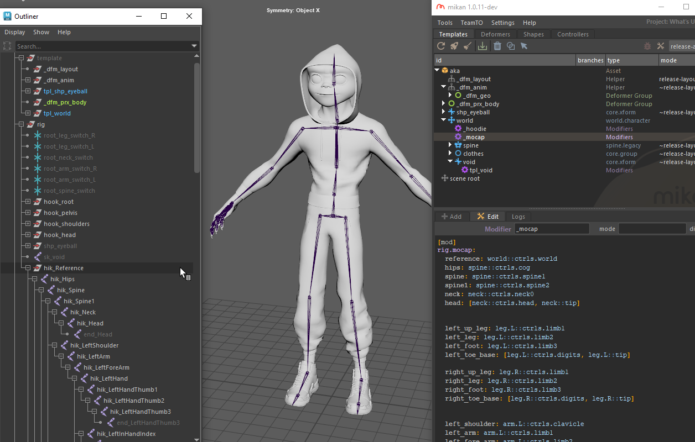

# rig.mocap

Generates a HumanIK-compatible motion capture (mocap) skeleton based on the controllers of an animated rig.

The generated skeleton is compatible with traditional motion capture pipelines (e.g., HumanIK in Maya, Tangerine). Motion data imported onto the mocap skeleton can subsequently be retargeted or transferred directly back to the rig anim controllers.

## Parameters

| Parameter     | Type                                 | Default | Description                                                                                                                                                                                   |
|---------------|--------------------------------------|---------|-----------------------------------------------------------------------------------------------------------------------------------------------------------------------------------------------|
| `reference`   | *plug \| node*                       |         | Reference controller node used as the base anchor for the mocap hierarchy (e.g., world or main placement controller).                                                                         | 
| `<hik_label>` | *plug \| node \| list[plug \| node]* |         | HumanIK joint definition. Maps a specific HIK bone label to a rig controller. Can accept a single controller node or a list of two nodes `[start, end]` to generate a tip joint/bone segment. |

:::note[Automatic End Joints]
When providing a pair of nodes `[start, end]` for a HumanIK slot (e.g., `head: [neck::ctrls.head, neck::tip]`), the modifier automatically builds an end joint to close the bone segment if no child joint is explicitly declared.
:::

## Outputs

The `rig.mocap` modifier constructs a complete hierarchical mocap skeleton:

- **Maya**: Automatically creates and hooks up a native **HumanIK Character** definition node connected to the generated joint hierarchy. This mocap skeleton can also be exported to FBX and is directly compatible with motion capture tools and libraries such as Mixamo or Rokoko.
- **Tangerine**: Generates the corresponding native mocap structure. This structure is consumed by internal animation retargeting tools upon FBX animation import, allowing custom studio scripts to transfer the imported mocap motion directly onto the designated animation controllers of the final rig.

### Hierarchy & Placement

The mocap skeleton is parented under the output node of the scope where the modifier is declared (typically a helper node at the root of the template).

If IK effector mappings are defined, dedicated helper locators are generated to facilitate animation transfer between the mocap IK targets and the rig's IK animation controllers.

### Generated Nodes & IDs

- **Node ID Pattern**: Each joint created within the mocap hierarchy is assigned the identifier: `<id>::mod.mocap.<mocap_id>`
- **Hook Attribute**: Each joint on the mocap skeleton receives a custom `gem_hook` attribute connected to its corresponding animation rig controller, enabling automated retargeting and transfer scripts.



## Example

### Standard Biped Definition

The following example demonstrates a standard biped HumanIK mapping setup, referencing the character's main limb, spine, digit, and IK controllers.

```yml
rig.mocap:
  reference: world::ctrls.world
  hips: spine::ctrls.cog
  spine: spine::ctrls.spine1
  spine1: spine::ctrls.spine2
  neck: neck::ctrls.neck0
  head: [ neck::ctrls.head, neck::tip ]

  # Legs
  left_up_leg: leg.L::ctrls.limb1
  left_leg: leg.L::ctrls.limb2
  left_foot: leg.L::ctrls.limb3
  left_toe_base: [ leg.L::ctrls.digits, leg.L::tip ]

  right_up_leg: leg.R::ctrls.limb1
  right_leg: leg.R::ctrls.limb2
  right_foot: leg.R::ctrls.limb3
  right_toe_base: [ leg.R::ctrls.digits, leg.R::tip ]

  # Arms
  left_shoulder: arm.L::ctrls.clavicle
  left_arm: arm.L::ctrls.limb1
  left_fore_arm: arm.L::ctrls.limb2
  left_hand: arm.L::ctrls.limb3

  right_shoulder: arm.R::ctrls.clavicle
  right_arm: arm.R::ctrls.limb1
  right_fore_arm: arm.R::ctrls.limb2
  right_hand: arm.R::ctrls.limb3

  # Left Hand Digits
  left_hand_thumb1: thumb.L::ctrls.0
  left_hand_thumb2: thumb.L::ctrls.1
  left_hand_thumb3: [ thumb.L::ctrls.2, thumb.L::tip ]

  left_in_hand_index: point.L::ctrls.0
  left_hand_index1: point.L::ctrls.1
  left_hand_index2: point.L::ctrls.2
  left_hand_index3: [ point.L::ctrls.3, point.L::tip ]

  left_in_hand_middle: middle.L::ctrls.0
  left_hand_middle1: middle.L::ctrls.1
  left_hand_middle2: middle.L::ctrls.2
  left_hand_middle3: [ middle.L::ctrls.3, middle.L::tip ]

  left_in_hand_ring: ring.L::ctrls.0
  left_hand_ring1: ring.L::ctrls.1
  left_hand_ring2: ring.L::ctrls.2
  left_hand_ring3: [ ring.L::ctrls.3, ring.L::tip ]

  left_in_hand_pinky: pinky.L::ctrls.0
  left_hand_pinky1: pinky.L::ctrls.1
  left_hand_pinky2: pinky.L::ctrls.2
  left_hand_pinky3: [ pinky.L::ctrls.3, pinky.L::tip ]

  # Right Hand Digits
  right_hand_thumb1: thumb.R::ctrls.0
  right_hand_thumb2: thumb.R::ctrls.1
  right_hand_thumb3: [ thumb.R::ctrls.2, thumb.R::tip ]

  right_in_hand_index: point.R::ctrls.0
  right_hand_index1: point.R::ctrls.1
  right_hand_index2: point.R::ctrls.2
  right_hand_index3: [ point.R::ctrls.3, point.R::tip ]

  right_in_hand_middle: middle.R::ctrls.0
  right_hand_middle1: middle.R::ctrls.1
  right_hand_middle2: middle.R::ctrls.2
  right_hand_middle3: [ middle.R::ctrls.3, middle.R::tip ]

  right_in_hand_ring: ring.R::ctrls.0
  right_hand_ring1: ring.R::ctrls.1
  right_hand_ring2: ring.R::ctrls.2
  right_hand_ring3: [ ring.R::ctrls.3, ring.R::tip ]

  right_in_hand_pinky: pinky.R::ctrls.0
  right_hand_pinky1: pinky.R::ctrls.1
  right_hand_pinky2: pinky.R::ctrls.2
  right_hand_pinky3: [ pinky.R::ctrls.3, pinky.R::tip ]

  # IK effectors
  left_ankle_effector: arm.L::ctrls.ik
  right_ankle_effector: arm.R::ctrls.ik
  left_wrist_effector: leg.L::ctrls.ik
  right_wrist_effector: leg.R::ctrls.ik
```